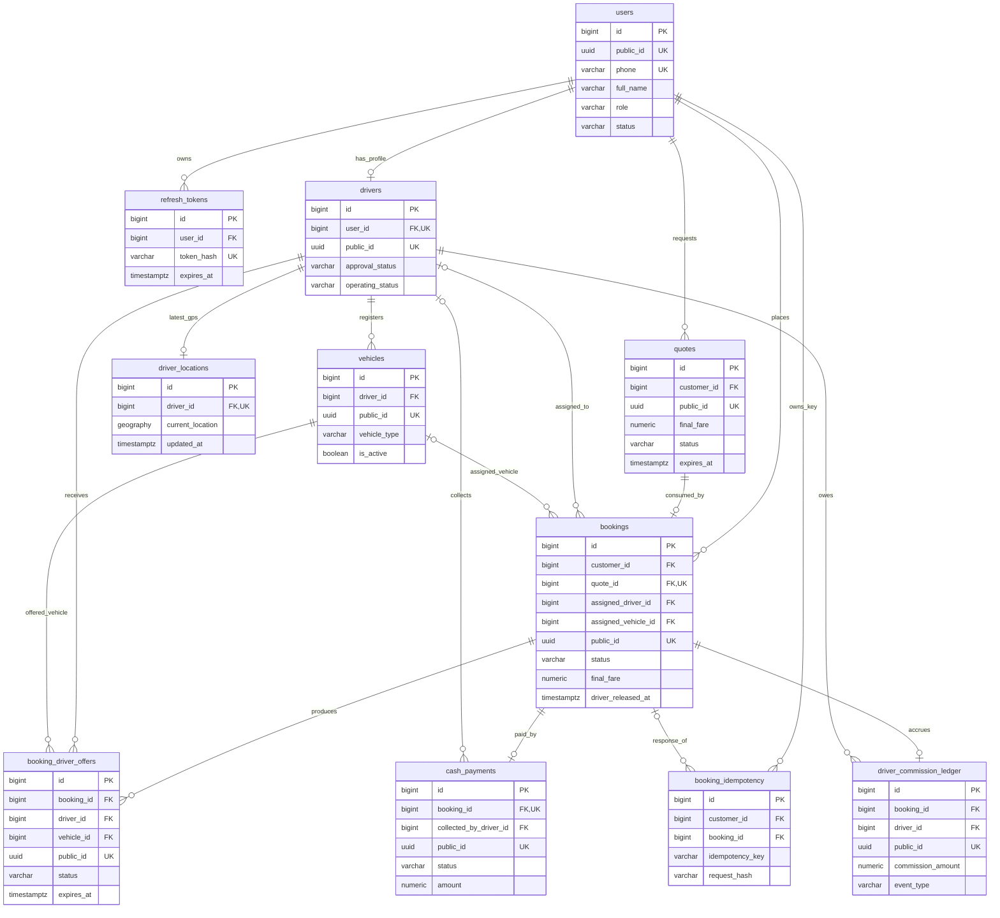

# GoMove ERD – Quan hệ các bảng nghiệp vụ

> Các đường nối thể hiện khóa ngoại của PostgreSQL; ký hiệu `o|` chỉ quan hệ **có thể không tồn tại** bản ghi phía con. ERD không vẽ các view/thành phần nội bộ của PostGIS và bảng Flyway để tránh nhiễu. `foundation_spatial_check` độc lập, là bảng kiểm tra nền tảng.

**Ghi chú về lực lượng quan hệ:** `bookings.quote_id` là NOT NULL + UNIQUE ⇒ một Quote có tối đa một Booking. `cash_payments.booking_id` cũng NOT NULL + UNIQUE ⇒ mỗi Booking có tối đa một Payment. `drivers.user_id UNIQUE` ⇒ một User có tối đa một Driver profile. Các FK nullable như `assigned_driver_id` không bắt buộc trong lúc tìm tài xế. `driver_commission_ledger` UNIQUE `(booking_id,event_type)` và hiện chỉ cho `COMMISSION_ACCRUED` ⇒ nhiều nhất một accrual/booking.

**Tham chiếu:** DDL chính xác và đầy đủ nằm trong Flyway V1–V13; `DATA_DICTIONARY.md` giải thích từng bảng. Tập tin `erd.png`/`erd.svg` là phiên bản hình minh họa đã đơn giản hóa để thuyết trình.
