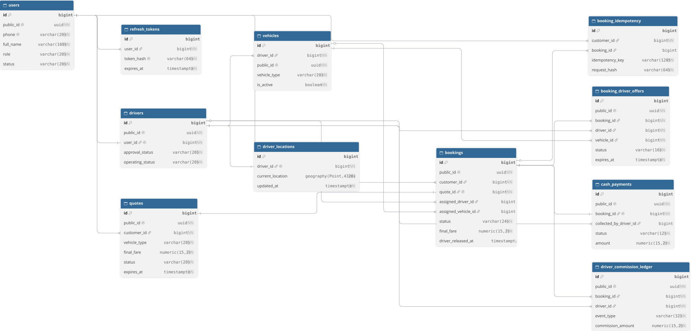

# GoMove — Cơ sở dữ liệu PostgreSQL / PostGIS (V13)

> **Trạng thái:** tài liệu mô tả cấu trúc schema Flyway **V1–V13** trên nhánh `main`. Các số liệu PostgreSQL/DBeaver ngày **15/10/2026** là snapshot lịch sử, **không phải số liệu thời gian thực**. ERD là sơ đồ minh họa; **SQL migrations** tại [`backend/src/main/resources/db/migration/`](../../backend/src/main/resources/db/migration/) mới là nguồn chuẩn khi có khác biệt.

## 1. Tổng quan

**GoMove** là hệ thống đặt xe gồm người đặt xe (**CUSTOMER**), tài xế (**DRIVER**) và người quản trị (**ADMIN**). Backend Java/Spring Boot kết nối PostgreSQL; PostGIS hỗ trợ tìm tài xế theo khoảng cách, Flyway quản lý thay đổi cấu trúc CSDL.

| Thành phần | Công nghệ / đặc điểm |
| --- | --- |
| CSDL quan hệ | PostgreSQL 16 (image `postgis/postgis:16-3.5`) |
| Mở rộng địa lý | PostGIS 3.5, `GEOGRAPHY(Point,4326)` |
| Quản lý schema | Flyway, 13 migration `V1`–`V13` |
| Khóa chính | `BIGINT` nội bộ; UUID `public_id` cho API khi có |
| Phân quyền | `users.role`: CUSTOMER / DRIVER / ADMIN |
| Dữ liệu giá | `NUMERIC`, VND, báo giá và giá booking chụp snapshot |
| CSDL trên máy dev | Container `gomove-postgres`, cổng 5432, database `gomove` |

**Số bảng tạo bởi các migration V1–V13: 12**, gồm **11 bảng chức năng** và **1 bảng kiểm tra không gian** (`foundation_spatial_check`). Flyway tạo riêng `flyway_schema_history`. PostGIS tạo `spatial_ref_sys` và các view metadata như `geography_columns`, `geometry_columns`; **đây không phải bảng nghiệp vụ GoMove**.

## 2. Các nhóm bảng

| Nhóm | Bảng | Mục đích |
| --- | --- | --- |
| Tài khoản | `users`, `refresh_tokens` | Người dùng, vai trò, quản lý phiên đăng nhập |
| Tài xế và xe | `drivers`, `vehicles`, `driver_locations` | Hồ sơ, duyệt tài xế, phương tiện, tọa độ GPS mới nhất |
| Báo giá/đặt xe | `quotes`, `bookings`, `booking_idempotency` | Báo giá có hạn, đơn đặt xe, chống yêu cầu trùng |
| Ghép chuyến | `booking_driver_offers` | Gửi đề nghị có hạn 15 giây cho tài xế |
| Thanh toán | `cash_payments`, `driver_commission_ledger` | CASH PENDING/PAID và hoa hồng phải thu |
| Hỗ trợ | `foundation_spatial_check` | Kiểm tra nền tảng PostGIS |


### 2.1. Chức năng, khóa chính (PK) và khóa ngoại (FK) theo từng bảng

**Quy ước:** `PK` là khóa chính; `FK` là khóa ngoại; `UQ` là ràng buộc không trùng; `NULL` nghĩa là có thể chưa có giá trị. **Cả 11 bảng nghiệp vụ đều có khóa chính `id BIGINT`**. Nhiều bảng có thêm `public_id UUID` để dùng làm mã công khai trong API; UUID này **không thay thế** khóa chính BIGINT trong các phép JOIN nội bộ.

| Bảng | Chức năng thực tế | Các FK quan trọng |
| --- | --- | --- |
| `users` | Danh tính, mật khẩu đã băm, trạng thái tài khoản, vai trò CUSTOMER / DRIVER / ADMIN | Không có FK đến bảng nghiệp vụ khác |
| `refresh_tokens` | Lưu **hash** token, thời hạn, trạng thái thu hồi và hỗ trợ refresh-token rotation | `user_id → users.id` |
| `drivers` | Hồ sơ tài xế, số giấy phép, `approval_status` và `operating_status` | `user_id → users.id`; `UNIQUE(user_id)` |
| `vehicles` | Xe, biển số, loại MOTORBIKE / CAR_4_SEAT / CAR_7_SEAT, trạng thái đang sử dụng | `driver_id → drivers.id` |
| `driver_locations` | **Vị trí GPS gần nhất** của tài xế, thời gian cập nhật và thông tin độ chính xác | `driver_id → drivers.id`; `UNIQUE(driver_id)` |
| `quotes` | Điểm đón/điểm đến, quãng đường, thời gian, các cấu phần giá, `pricing_snapshot JSONB`, hạn 60 giây | `customer_id → users.id` |
| `bookings` | Bảng trung tâm: đơn đặt xe, giá chốt, người đặt, tài xế/xe được phân công và các mốc vòng đời chuyến | `customer_id → users.id`; `quote_id → quotes.id` (`UQ`); `assigned_driver_id → drivers.id` (`NULL`); `assigned_vehicle_id → vehicles.id` (`NULL`) |
| `booking_idempotency` | Giữ khóa nghiệp vụ theo Customer, băm nội dung request và phản hồi gốc; chống tạo đơn trùng khi retry | `customer_id → users.id`; `booking_id → bookings.id` (`NULL`) |
| `booking_driver_offers` | Lưu từng đề nghị nhận chuyến gửi cho tài xế và xe, trạng thái, thời điểm gửi/hết hạn | `booking_id → bookings.id`; `driver_id → drivers.id`; `vehicle_id → vehicles.id` |
| `cash_payments` | Thanh toán tiền mặt cho Booking: phương thức CASH, trạng thái PENDING/PAID, người nhận tiền và thời gian | `booking_id → bookings.id` (`UQ`); `collected_by_driver_id → drivers.id` (`NULL`) |
| `driver_commission_ledger` | Bút toán hoa hồng **nền tảng phải thu từ tài xế**, kèm tỷ lệ, số tiền và phiên bản chính sách | `booking_id → bookings.id`; `driver_id → drivers.id` |

**Bảng thứ 12** là `foundation_spatial_check`: bảng **kỹ thuật** dùng kiểm chứng PostGIS, không tham gia quy trình đặt xe. `flyway_schema_history` là bảng lịch sử migration do Flyway quản lý, không tính vào 12 bảng của ứng dụng.

### 2.2. Các quan hệ 1–1 và 1–nhiều cần trình bày

| Quan hệ | Kiểu quan hệ | Ý nghĩa |
| --- | --- | --- |
| `users → refresh_tokens` | 1–N | Một người dùng có thể có nhiều phiên đăng nhập |
| `users → drivers` | 1–0..1 | Một tài khoản có tối đa một hồ sơ tài xế, nhờ `drivers.user_id UNIQUE` |
| `drivers → vehicles` | 1–N | Một tài xế có thể khai báo nhiều xe; tối đa một xe đang active nhờ partial unique index |
| `drivers → driver_locations` | 1–0..1 | Lưu một vị trí GPS mới nhất cho mỗi tài xế |
| `users → quotes` và `users → bookings` | 1–N | Một khách hàng có thể tạo nhiều báo giá và Booking |
| `quotes → bookings` | 1–0..1 | Một báo giá chỉ được dùng để tạo tối đa một Booking |
| `bookings → booking_driver_offers` | 1–N | Một Booking có thể từng được mời lần lượt tới nhiều Driver |
| `bookings → cash_payments` | 1–0..1 | Một Booking có tối đa một bản ghi thanh toán CASH |
| `bookings → driver_commission_ledger` | 1–0..1 với nghiệp vụ V13 | Ledger hiện có sự kiện `COMMISSION_ACCRUED` duy nhất cho mỗi Booking |

**Quan hệ sở hữu phức hợp:** CSDL còn có FK phức hợp để bảo đảm xe được phân công thực sự thuộc tài xế và bản ghi thu tiền/hoa hồng thuộc đúng Driver của Booking. Các cặp khóa đầy đủ được mô tả trong [DBML kỹ thuật](gomove_v13.dbml), không vẽ hết ở ERD trình bày.


## 3. Sơ đồ ERD

### 3.1. ERD rút gọn — dùng để thuyết trình



[Mở SVG rút gọn](erd_presentation.svg) · [DBML trình bày (có thể chỉnh sửa trên dbdiagram.io)](gomove_v13_presentation.dbml)

### 3.2. ERD đầy đủ và tài liệu kỹ thuật

[Mở SVG đầy đủ](erd_full.svg) · [DBML đầy đủ](gomove_v13.dbml) · [Sơ đồ quan hệ Mermaid](ERD.md) · [Từ điển dữ liệu](DATA_DICTIONARY.md)

> **Lưu ý:** ERD rút gọn chỉ có các cột và quan hệ chính để người xem dễ theo dõi. Không phải mọi index, CHECK, FK phức hợp và trigger đều được vẽ. Khi triển khai hay bảo vệ ràng buộc kỹ thuật phải đối chiếu với DDL của Flyway V1–V13.

**Tài liệu hỗ trợ:** [SQL demo](DEMO_QUERIES.sql) · [Lời dẫn trình bày](PRESENTATION.md) · [Checklist bằng chứng](EVIDENCE_CHECKLIST.md) · [DBeaver snapshot 15/10/2026](VERIFIED_SNAPSHOT_2026-10-15.md)

## 4. Luồng nghiệp vụ ↔ CSDL

1. **Đăng ký/đăng nhập:** `users` ghi tài khoản; `refresh_tokens` lưu **băm** token (không lưu token thô).
2. **Driver onboarding:** hồ sơ `drivers` gắn một `users`, cần `APPROVED`; mỗi driver có thể có nhiều `vehicles`, tối đa một xe đang `is_active = TRUE`.
3. **GPS:** `driver_locations` lưu vị trí cuối của mỗi tài xế, có GiST index hỗ trợ truy vấn bán kính bằng PostGIS. Khi dispatch chỉ chọn GPS đủ mới.
4. **Báo giá:** `quotes` gồm tọa độ, OSRM distance/duration, cấu phần giá, `pricing_snapshot JSONB`, `ISSUED/CONSUMED/EXPIRED`, hạn dùng **60 giây do Backend áp dụng**.
5. **Đặt xe:** `bookings` sao chép thông tin và giá chấp nhận từ quote. `UNIQUE(quote_id)` + `booking_idempotency` chống tạo hai đơn từ cùng báo giá/khóa nghiệp vụ.
6. **Ghép tài xế:** `booking_driver_offers` ghi offer và `expires_at = offered_at + 15 seconds`; chấp nhận hợp lệ mới gán driver/vehicle và chuyển driver `BUSY`.
7. **Vòng đời chuyến:** `bookings.status`: REQUESTED → SEARCHING_DRIVER → DRIVER_ACCEPTED → DRIVER_ARRIVED → PASSENGER_ONBOARD → IN_PROGRESS → COMPLETED (điều kiện chuyển trạng thái do Backend kiểm soát).
8. **CASH:** `cash_payments` tạo PENDING khi đặt xe, chỉ PAID sau COMPLETED được xác nhận; `driver_commission_ledger` thêm bản ghi COMMISSION_ACCRUED, **không phải bằng chứng nền tảng đã thu tiền hoa hồng**.


### 4.1. Từ khách hàng đến Booking

Khách hàng đăng nhập với tài khoản trong `users`; `refresh_tokens` phục vụ duy trì và làm mới phiên, **chỉ lưu token hash**, không lưu refresh token dạng thuần văn bản. Khi chọn điểm đón/điểm đến và loại xe, Backend gọi adapter định tuyến **OSRM** để nhận khoảng cách và thời lượng rồi lưu báo giá trong `quotes`. `pricing_snapshot JSONB` và `pricing_engine_version` giữ cách tính giá; báo giá có thời hạn **60 giây**, do Backend kiểm soát hiệu lực.

Khi khách xác nhận, Backend kiểm tra `Idempotency-Key` trước khi tiêu thụ Quote rồi đồng thời ghi `booking_idempotency`, đánh dấu Quote `CONSUMED` và tạo `bookings` trong transaction. `bookings.final_fare` là giá khách đã chấp nhận, không tự tính lại khi chuyến đang chạy. Hai FK `assigned_driver_id`, `assigned_vehicle_id` **có thể NULL** vì lúc tạo đơn chưa tìm được tài xế.

### 4.2. Tìm tài xế và tạo đề nghị 15 giây

Ứng viên nhận chuyến cần có hồ sơ `drivers` được `APPROVED`, đang `ONLINE`, có `vehicles.is_active` phù hợp và GPS đủ mới trong `driver_locations`. PostGIS lưu vị trí dưới dạng `GEOGRAPHY(Point,4326)`, hỗ trợ GiST index và truy vấn khoảng cách theo **mét**.

`booking_driver_offers` lưu lần mời một Driver/Vehicle; có thời điểm `offered_at`, `expires_at`, `responded_at` và trạng thái PENDING / ACCEPTED / REJECTED / EXPIRED. CHECK ràng buộc `expires_at = offered_at + INTERVAL '15 seconds'`. **Offer không phải assignment**: chỉ khi Driver chấp nhận hợp lệ trước hạn, `bookings` mới được gán tài xế/xe và Driver trở thành `BUSY`. Unique/partial unique index bảo vệ các offer và phân công đồng thời.

### 4.3. Vòng đời chuyến và cập nhật GPS

`bookings.status` tuần tự: `REQUESTED → SEARCHING_DRIVER → DRIVER_ACCEPTED → DRIVER_ARRIVED → PASSENGER_ONBOARD → IN_PROGRESS → COMPLETED`. Các cột thời gian `driver_accepted_at`, `driver_arrived_at`, `passenger_onboard_at`, `trip_started_at` và `trip_completed_at` phục vụ đối chiếu lịch sử chuyển trạng thái. Backend kiểm soát chuyển trạng thái hợp lệ; database có CHECK bảo vệ timestamp/assignment.

WebSocket/STOMP hỗ trợ theo dõi gần thời gian thực trong chuyến; **PostgreSQL mới là nguồn dữ liệu chuẩn**. Sau `COMPLETED`, vị trí Driver không tiếp tục được trả cho khách qua API tracking của chuyến cũ.

### 4.4. Tiền mặt, công nợ hoa hồng và giải phóng tài xế

`cash_payments` tạo giao dịch CASH ở trạng thái `PENDING` với giá khớp `bookings.final_fare`. Chỉ sau `COMPLETED` và Driver xác nhận **thực sự đã thu tiền mặt**, payment mới chuyển `PAID`. Khi đó `driver_commission_ledger` ghi `COMMISSION_ACCRUED` và `bookings.driver_released_at` được thiết lập để giải phóng Driver khỏi assignment.

**Điểm quan trọng khi thuyết trình:** `COMMISSION_ACCRUED` là **hoa hồng phải thu**, *không đồng nghĩa nền tảng đã nhận tiền*. Phiên bản V13 không tạo ví thu nhập ảo cho tiền mặt mà khách trực tiếp đưa tài xế.

## 5. Những ràng buộc thiết kế đáng trình bày

- **PK/FK và UUID:** CSDL dùng khóa số để join hiệu quả; API chỉ xuất UUID công khai; `users`–`drivers` 1–0..1 qua `drivers.user_id UNIQUE`.
- **One active vehicle:** partial unique index `ux_vehicles_one_active_per_driver`.
- **One quote → max one booking:** `uq_bookings_quote_id`.
- **Idempotency theo khách:** `uq_booking_idempotency_customer_key`.
- **Offer chính xác 15 giây:** `chk_offer_exact_lease`; các unique partial index ngăn 2 offer PENDING cùng lúc cho cùng booking/driver.
- **Một assignment đang giữ:** `uq_bookings_active_driver` lọc `driver_released_at IS NULL`.
- **Tiền:** `quotes.chk_quotes_fare_reconciliation`, `cash_payments` giữ đúng giá chấp nhận, ledger `NUMERIC` và kiểm tra commission.
- **Bất biến lịch sử:** trigger từ V13 ngăn sửa/xóa ledger đã ghi và chặn sửa thanh toán PAID.
- **GPS:** `GEOGRAPHY(Point,4326)` + GiST; thứ tự tạo point nội bộ là `(longitude, latitude)`.

## 6. Tái tạo database từ GitHub

**Schema chuẩn được lưu ở** [`backend/src/main/resources/db/migration/`](../../backend/src/main/resources/db/migration/) với `V1`–`V13`. Không chạy thủ công từng migration lên database đã được Flyway quản lý, và **không sửa V1–V13**.

```powershell
# Từ thư mục gốc repository
cd D:\goMove
docker compose up -d postgres
docker compose ps

# Ở cửa sổ khác: cấu hình JWT_SECRET trong môi trường dev rồi chạy backend
cd D:\goMove\backend
.\mvnw.cmd spring-boot:run
```

Khi Spring Boot khởi động, Flyway sẽ áp các migration chưa thực hiện; kiểm tra kết quả bằng `SELECT version, description, success FROM flyway_schema_history ORDER BY installed_rank;`. Không dùng `docker compose down -v` trên DB đang chứa dữ liệu thật.

**Bảo mật khi đăng GitHub public:** Chỉ đưa schema, ERD, câu truy vấn và **dữ liệu giả đã kiểm duyệt**; không đưa file `.env`, mật khẩu, `JWT_SECRET`, `password_hash`, `token_hash`, số điện thoại thật, vị trí GPS của người thật hoặc dump đầy đủ DB đang chạy.


## 7. Demo SQL trên DBeaver (chỉ đọc, không chỉnh sửa dữ liệu)

**1. Xác nhận PostgreSQL 16 và PostGIS 3.5:**

```sql
SELECT current_setting('server_version') AS postgresql_version,
       postgis_version() AS postgis_version;
```

**2. Kiểm tra Flyway V1–V13:**

```sql
SELECT version, description, success
FROM flyway_schema_history
ORDER BY installed_rank;
```

**3. Tổng hợp tình trạng Booking không để lộ thông tin cá nhân:**

```sql
SELECT status, COUNT(*) AS so_chuyen
FROM bookings
GROUP BY status
ORDER BY status;
```

**4. Đối chiếu Booking — Quote — Payment bằng UUID công khai:**

```sql
SELECT b.public_id AS booking_uuid,
       b.status AS booking_status,
       q.public_id AS quote_uuid,
       b.final_fare,
       p.status AS cash_status
FROM bookings b
JOIN quotes q ON q.id = b.quote_id
LEFT JOIN cash_payments p ON p.booking_id = b.id
ORDER BY b.created_at DESC
LIMIT 10;
```

**5. Đối chiếu các offer nhận chuyến:**

```sql
SELECT b.public_id AS booking_uuid,
       o.public_id AS offer_uuid,
       o.status, o.offered_at, o.expires_at, o.responded_at
FROM booking_driver_offers o
JOIN bookings b ON b.id = o.booking_id
ORDER BY o.offered_at DESC
LIMIT 10;
```

**6. Hoa hồng phải thu (có thể trả về 0 dòng nếu chưa xác nhận CASH):**

```sql
SELECT b.public_id AS booking_uuid,
       l.event_type, l.gross_cash_fare,
       l.commission_rate, l.commission_amount
FROM driver_commission_ledger l
JOIN bookings b ON b.id = l.booking_id
ORDER BY l.occurred_at DESC
LIMIT 10;
```

Xem thêm [DEMO_QUERIES.sql](DEMO_QUERIES.sql). **Không chạy UPDATE/DELETE/INSERT thủ công để tạo bằng chứng demo.**

## 8. Kết quả kiểm chứng trên PostgreSQL development (15/10/2026)

DBeaver đã cho thấy **13/13 Flyway migrations V1–V13 thành công**, cùng `users = 3`, `drivers = 1`, `vehicles = 1`, `driver_locations = 1`, `quotes = 3`, `bookings = 3`, `booking_driver_offers = 3`, `cash_payments = 3`, `driver_commission_ledger = 0`. Đây là số liệu ảnh chụp lúc khoảng 09:27–09:28 ngày 15/10/2026, không phải dữ liệu được commit lên GitHub. Xem [snapshot và giới hạn xác minh](VERIFIED_SNAPSHOT_2026-10-15.md).


## 9. Bảo mật và an toàn sao lưu

- **Không đưa lên GitHub public**: `JWT_SECRET`, mật khẩu, file `.env`, access/refresh token, `password_hash`, `token_hash`, số điện thoại thật, tọa độ GPS riêng tư hoặc bản dump dữ liệu có thông tin cá nhân.
- API sử dụng `public_id UUID` để tránh lộ khóa nội bộ; **UUID không thay thế xác thực và phân quyền** theo user/role/ownership tại Backend.
- `GEOGRAPHY(Point,4326)` dùng tọa độ trong thứ tự tạo điểm **(longitude, latitude)**; API nhận kinh độ/vĩ độ theo hợp đồng riêng.
- **GitHub sao lưu mã nguồn và migrations, không sao lưu các Booking hoặc Payment đang tồn tại trong Docker volume**. Trước khi dọn ổ đĩa phải có bản `pg_dump` riêng và xác minh có thể phục hồi.

## 10. Hướng phát triển — chưa thuộc schema V13

Các ý tưởng dưới đây là **dự kiến**, không phải bảng đã triển khai trong ERD hiện tại:

- Đánh giá và nhận xét giữa Customer và Driver sau chuyến.
- Tra cứu/lọc lịch sử chuyến và thống kê hoạt động/hiệu quả vận hành, tận dụng `bookings` hiện có.
- Dashboard quản trị và các báo cáo tổng hợp công nợ, tỷ lệ nhận chuyến, thời gian phục vụ.
- Theo dõi khoản hoa hồng **đã thực nộp** riêng với `COMMISSION_ACCRUED` và quy trình đối soát.
- Thanh toán online nếu sau này có điều kiện về cổng thanh toán, tích hợp và ngân sách; **V13 hiện chỉ hỗ trợ CASH**.

## 11. Nguồn tham chiếu

| Tài liệu | Vai trò |
| --- | --- |
| [ERD Presentation SVG](erd_presentation.svg) / [DBML trình bày](gomove_v13_presentation.dbml) | Sơ đồ rút gọn cho thầy/các bạn xem |
| [ERD Full SVG](erd_full.svg) / [DBML đầy đủ](gomove_v13.dbml) | Schema chi tiết và các FK phức hợp |
| [ERD.md](ERD.md) | Sơ đồ Mermaid các quan hệ PK/FK |
| [DATA_DICTIONARY.md](DATA_DICTIONARY.md) | Cột, kiểu, ý nghĩa, constraint |
| [PRESENTATION.md](PRESENTATION.md) | Gợi ý thuyết trình theo luồng |
| [VERIFIED_SNAPSHOT_2026-10-15.md](VERIFIED_SNAPSHOT_2026-10-15.md) | Bằng chứng dev ngày 15/10, không phải dữ liệu hiện tại |
| [EVIDENCE_CHECKLIST.md](EVIDENCE_CHECKLIST.md) | Checklist kiểm chứng kỹ thuật |
| [Flyway V1–V13](../../backend/src/main/resources/db/migration/) | **SQL chuẩn** để tái tạo schema |
